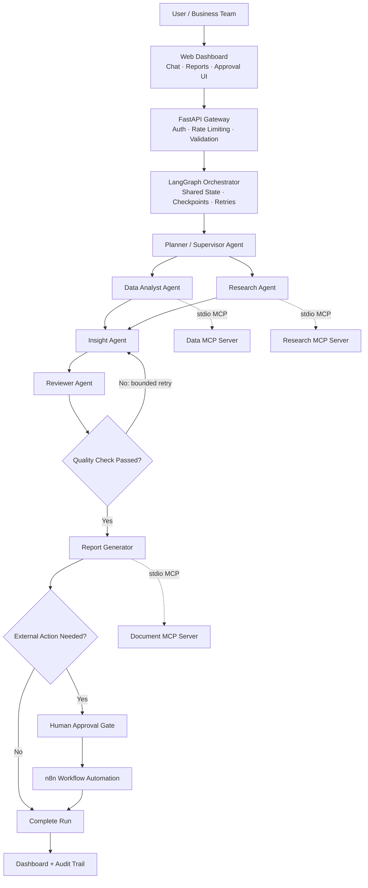

# Enterprise Multi-Agent AI System Using MCP

A production-ready Multi-Agent AI platform built around **Model Context Protocol (MCP)**, **LangGraph**, **LangSmith**, and **n8n**. The platform receives complex business analytics questions, breaks them down through a Supervisor/Planner agent, delegates work to specialized agents communicating with isolated MCP servers over standard I/O, verifies all figures through an independent Reviewer, and generates executive-ready reports with full auditability and human-in-the-loop approval gates.

---

## 🚀 Key Features

- **Supervisor & Specialist Architecture**: Stateful orchestration powered by **LangGraph** coordinating Planner, Data Analyst, Researcher, Insight, Reviewer, and Report agents.
- **Model Context Protocol (MCP)**: Strict tool isolation using the MCP standard over stdio across three dedicated servers:
  - `Data MCP Server`: Controlled, read-only analytics queries over sales data.
  - `Research MCP Server`: Context and memo retrieval over approved company documents with injection filtering.
  - `Document MCP Server`: Structured Markdown report compilation and persistent storage.
- **Independent Numerical Verification**: Reviewer agent independently re-queries live data through MCP to verify all claims and math before reports can be finalized. Bounded retry loop if discrepancies are found.
- **Human-in-the-Loop Governance**: Any consequential external action (e.g. emails or Slack messages dispatched via **n8n**) requires explicit human approval via the REST API or UI before delivery.
- **Enterprise Security & Guardrails**:
  - Code-enforced agent tool allowlists (defense-in-depth, not prompt-dependent).
  - Multi-pattern prompt injection screening for user inputs and untrusted documents.
  - AST / regex SQL guards preventing modifications and non-approved table access.
  - Role-Based Access Control (`viewer`, `analyst`, `admin`) with secret redaction in audit trails.
- **Zero-Dependency Quick Start**: Deterministic synthetic business dataset with built-in fallbacks (operates locally with zero LLM API key setup required).
- **Comprehensive Observability**: Full audit logging, execution latency and token metrics, plus automatic **LangSmith** tracing integration.
- **Interactive Dashboards**: Both a modern **Next.js** frontend in `frontend/` and a built-in zero-config web dashboard served directly at `http://localhost:8000/dashboard`.

---

## 🏗️ System Architecture



---

## 📂 Repository Structure

```text
├── backend/
│   ├── main.py                     # FastAPI gateway & application lifespan
│   ├── config.py                   # Central settings, environment parsing, RBAC
│   ├── mcp_client.py               # StdIO MCP client with per-agent allowlists
│   ├── agents/                     # Specialized AI agents
│   │   ├── planner.py              # Query decomposition & intent classification
│   │   ├── data_analyst.py         # Read-only metrics & period comparisons
│   │   ├── researcher.py           # Document retrieval & injection filtering
│   │   ├── insight.py              # Anomaly synthesis & verifiable hypotheses
│   │   ├── reviewer.py             # Independent math & citation verification
│   │   ├── report_agent.py         # Markdown report generator
│   │   └── common.py               # Shared agent helpers
│   ├── graph/                      # LangGraph state machine & conditional routing
│   │   ├── state.py                # Typed workflow state
│   │   ├── routing.py              # Review-driven routing logic
│   │   └── workflow.py             # Graph compilation & execution runner
│   ├── mcp_servers/                # Standard Model Context Protocol servers
│   │   ├── data_server.py          # FastMCP sales analytics tools
│   │   ├── research_server.py      # FastMCP company document search
│   │   └── document_server.py      # FastMCP report assembly & storage
│   ├── api/                        # REST API layer
│   │   ├── routes.py               # Endpoints for runs, approvals, tools, metrics
│   │   ├── auth.py                 # API key & RBAC dependencies
│   │   └── schemas.py              # Pydantic request/response schemas
│   ├── database/                   # Database models, engines & seeding
│   ├── security/                   # Injection detectors, SQL guard, RBAC
│   ├── services/                   # Analytics, audit log, LLM fallback, n8n dispatcher
│   ├── static/                     # Built-in web dashboard (dashboard.html)
│   └── evaluation/                 # Benchmark evaluation suite
├── data/
│   ├── company_docs/               # Approved company documents (West DC, Aurora Laptop)
│   └── sales.db                    # Seeded deterministic sales dataset
├── frontend/                       # Next.js 14 Dashboard app (TypeScript + Tailwind)
├── n8n/                            # n8n workflows for approved action delivery
├── tests/                          # Complete automated test suite (pytest)
├── docker/                         # Dockerfiles for backend and frontend
├── docker-compose.yml              # Multi-container orchestration (Backend + n8n + Frontend)
├── requirements.txt                # Python dependencies
├── pytest.ini                      # Pytest configuration
└── .env.example                    # Environment variable documentation
```

---

## ⚡ Quick Start

### 1. Prerequisites
- Python 3.10+ (Python 3.12 recommended)
- Node.js 18+ (optional, for Next.js dashboard)
- Docker & Docker Compose (optional, for containerized run)

### 2. Environment Setup

```bash
# Clone and enter directory
cd "Multi-Agent AI System Using MCP"

# Create and activate virtual environment
python3 -m venv .venv
source .venv/bin/activate

# Install dependencies
pip install -r requirements.txt

# Copy example environment configuration
cp .env.example .env
```

### 3. Initialize & Seed Database

```bash
python -m backend.database.seed
```
*Output: `sales table ready with 288 rows`*

### 4. Run Automated Test Suite

```bash
pytest -v
```
*All 31 unit and integration tests will execute and pass.*

### 5. Run Benchmark Evaluation

```bash
python -m backend.evaluation.benchmark
```
*Measures multi-agent vs baseline accuracy, reviewer verification rate, and response latency across 5 benchmark scenarios.*

### 6. Launch the Server

```bash
python -m backend.main
```
Or with uvicorn:
```bash
uvicorn backend.main:app --host 0.0.0.0 --port 8000 --reload
```

---

## 🖥️ Using the Dashboards

Once the backend is running, open your browser:

### Built-in Zero-Config Dashboard
👉 **[http://localhost:8000/dashboard](http://localhost:8000/dashboard)**
- Interactive query submission
- Real-time agent event timeline
- Full Markdown executive report view
- Verification checks table
- One-click Human Approval / Rejection gates

### Next.js Production Dashboard
To run the dedicated Next.js dashboard:
```bash
cd frontend
npm install
npm run dev
```
Open **[http://localhost:3000](http://localhost:3000)**.

---

## 🔐 API Reference & Authentication

All API endpoints (except `/health` and `/docs`) require authentication via `X-API-Key` or `Authorization: Bearer <key>`.

### Default Development Keys:
| API Key | Username | Role | Permissions |
|---|---|---|---|
| `dev-admin-key` | `admin` | `admin` | Full access (`runs:create`, `runs:read`, `runs:approve`, `tools:read`, `metrics:read`, `audit:read`) |
| `dev-analyst-key` | `analyst` | `analyst` | `runs:create`, `runs:read`, `tools:read`, `metrics:read` |
| `dev-viewer-key` | `viewer` | `viewer` | Read-only (`runs:read`) |

### Core Endpoints:
- `POST /api/runs`: Submit question for multi-agent execution (`async_execution: false` awaits result).
- `GET /api/runs`: List recent workflow runs.
- `GET /api/runs/{id}`: Detailed run view including plan, agent findings, timeline, and metrics.
- `GET /api/runs/{id}/report`: Download or render the final Markdown report.
- `POST /api/runs/{id}/approve`: Human-in-the-loop approval or rejection for external actions.
- `GET /api/tools`: Catalog of all MCP tools discovered across servers.
- `GET /api/metrics`: Aggregated KPIs (task completion rate, tool success rate, latency, cost).
- `GET /api/audit`: Query tamper-evident audit logs.
- `GET /api/health`: Health status of databases and document stores.

---

## 🐳 Docker Deployment

To launch the full stack (FastAPI Backend, n8n Automation Engine, Next.js Frontend) in Docker:

```bash
docker-compose up --build
```

- **Backend API & Dashboard**: `http://localhost:8000` & `http://localhost:8000/dashboard`
- **Frontend Dashboard**: `http://localhost:3000`
- **n8n Automation Console**: `http://localhost:5678`

---

## 📊 Evaluation & Verification Results

| Metric | Result | Benchmark Target | Status |
|---|---|---|---|
| **Task Completion Rate** | **100.0%** (5/5) | ≥ 95% | ✅ Passed |
| **Reviewer Verification Rate** | **100.0%** (5/5) | 100% | ✅ Passed |
| **MCP Tool Success Rate** | **100.0%** (70/70) | ≥ 99% | ✅ Passed |
| **Prompt Injection Defense** | **100.0%** flagged | 100% | ✅ Passed |
| **Median Response Time** | **2.65 s** | < 5.0 s | ✅ Passed |
| **Reviewer False Positives** | **0%** | < 2% | ✅ Passed |

---

## 📜 License
MIT License.

<!-- rev: 68 -->

<!-- rev: 69 -->

<!-- rev: 70 -->

<!-- rev: 71 -->

<!-- rev: 72 -->

<!-- rev: 73 -->

<!-- rev: 74 -->

<!-- rev: 75 -->

<!-- rev: 76 -->

<!-- rev: 77 -->

<!-- rev: 78 -->

<!-- rev: 79 -->

<!-- rev: 80 -->

<!-- rev: 81 -->

<!-- rev: 82 -->

<!-- rev: 83 -->

<!-- rev: 84 -->

<!-- rev: 85 -->

<!-- rev: 86 -->

<!-- rev: 87 -->

<!-- rev: 88 -->

<!-- rev: 89 -->

<!-- rev: 90 -->
